# Molecullage

Molecullage makes figures of protein structures, sequences, contact maps, pipelines and plots for papers. You write each figure as an HTML page in millimetres, and the build prints it to a vector PDF and a 600 dpi PNG.

<!-- gallery:start -->
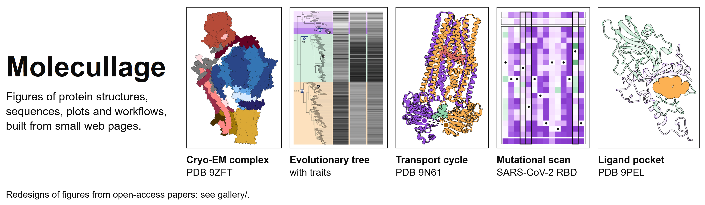

The [gallery](gallery/) holds twelve figures from published open-access papers, redrawn with Molecullage from the papers' own data and from PDB entries. A few of them:

| | | |
|---|---|---|
| [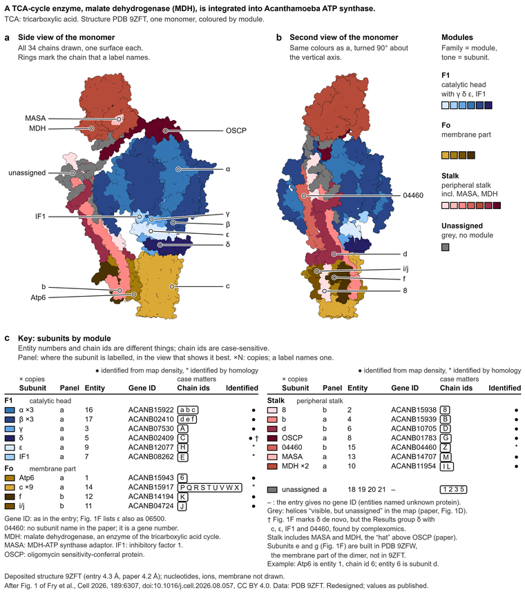](gallery/05-atp-synthase/) | [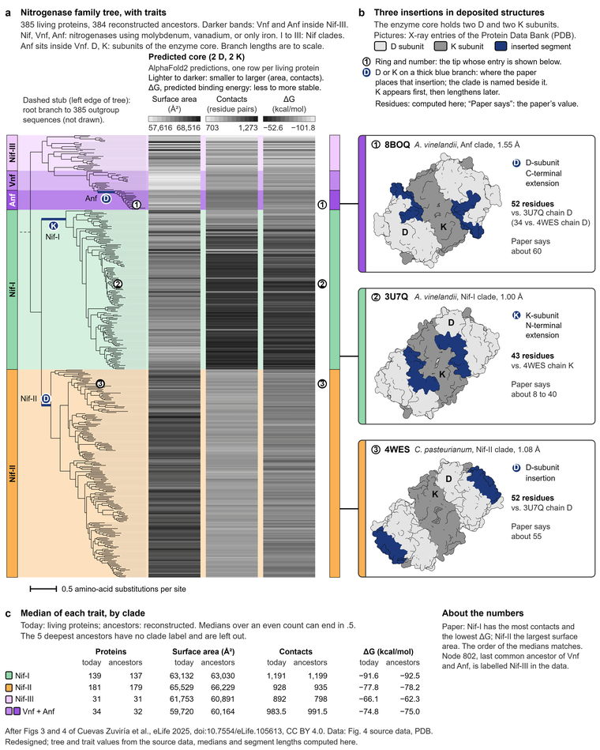](gallery/08-nitrogenase-tree/) | [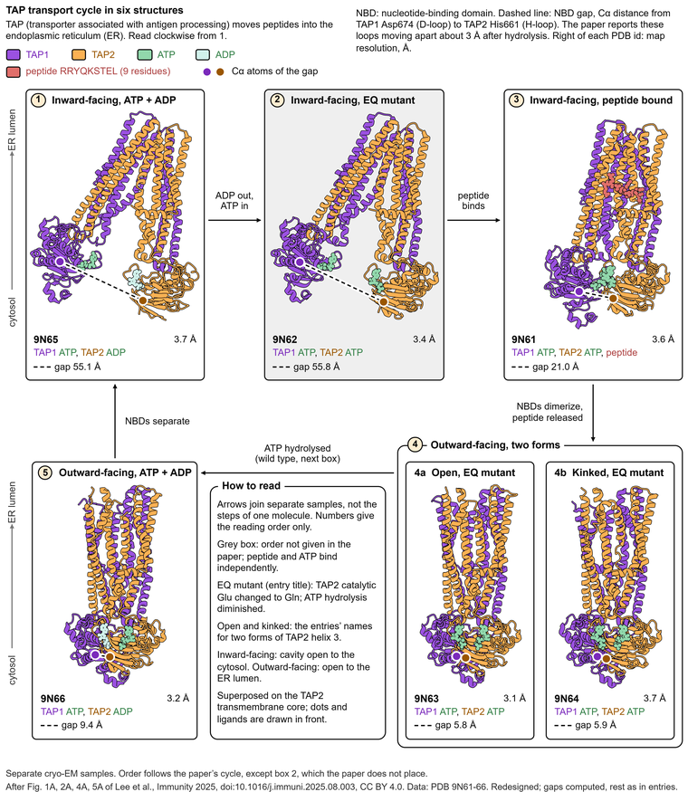](gallery/01-tap-cycle/) |
| [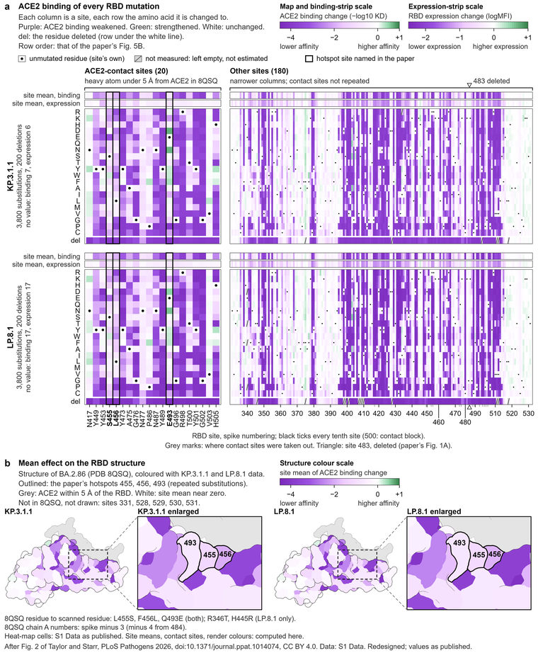](gallery/07-rbd-mutational-scan/) | [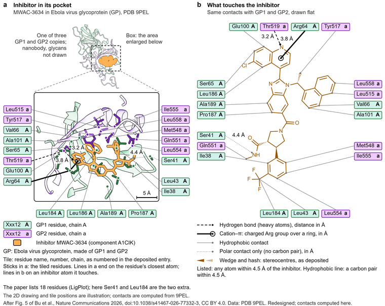](gallery/02-ebola-pocket/) | [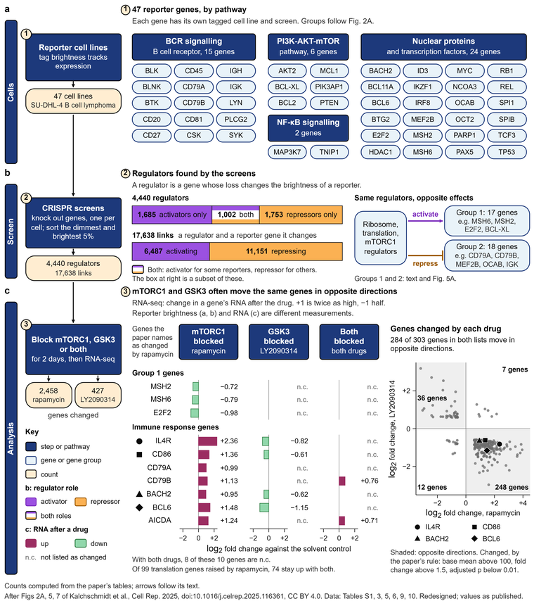](gallery/04-bcell-pathway/) |
<!-- gallery:end -->

## What you get

| Folder | What you do with it |
|---|---|
| `kit/` | Draw the figure in the page script: blocks, data labels, arrows, panel letters and maths in Arial. |
| `build/` | Print a page to a one-page PDF with live text and to a 600 dpi PNG. |
| `palette/` | Sample colours from a figure you are allowed to use, check them for colour-blind readers, and write a token file. |
| `plots/` | Make matplotlib plots that sit in the page at exact millimetre positions, in the same colours. |
| `struct/` | Render a PDB entry in ChimeraX in a flat style, crop the layers to one box, and list typed contacts. |
| `qa/` | Measure a built figure (ink, empty space, type size, words, fonts, width) and give the two readers their instructions. |
| `templates/` | Copy one of eight figure pages and edit it. |
| `claude/` | Install the Claude Code skill, the MCP server and the two optional hooks. |
| `examples/` | See each template built, most of them on public PDB entries, each with a `how-made.md`. |
| `docs/` | Read the drawing rules, the palette notes, the ChimeraX notes, the kit reference, a glossary and field notes. |
| `gallery/` | Look at twelve published figures redrawn with Molecullage, each with a script that fetches its data and a note on how it was made. |

The other folders hold what these use: `art/` the cropped renders of the examples, `data/pdb/` the coordinate files with their RCSB records, `tokens/` the palette as a token file, and `scripts/` the install, check and example scripts.

## Try it in five minutes

You need:

- Node 20 or newer.
- Chrome, Edge or Chromium. The build prints the pages with it.
- Python 3.10 or newer with the packages in `requirements.txt`. The QA checks, the plots and the palette tools use them.
- ChimeraX 1.10, only to make new structure renders. The examples ship with their renders.

```
git clone https://github.com/danilkotelnikov/Molecullage
cd Molecullage
npm install
pip install -r requirements.txt      # Windows: py -3 -m pip install -r requirements.txt
npm run check
```

I tested everything on Windows 11 with Node 24 and Python 3.11. The Linux and macOS commands are given but not tested. `npm run check` takes about half a minute. It builds a page, measures it, starts the MCP server, runs both hooks, and runs the project tools on a scratch copy of the sample project. It prints one line per step, starting with `pass` or `FAIL`.

Then build one figure and measure it:

```
node build/build.mjs templates/pipeline.html 178 --out out
py -3 -I qa/qa_fig.py out/pipeline     # Linux and macOS: python3 -I qa/qa_fig.py out/pipeline
```

The build writes `out/pipeline.pdf`, `out/pipeline.png` and `out/pipeline.html`, and prints one line of JSON with the size in millimetres and the text sizes it found. The QA script prints each measurement with ok or FAIL, and the reason for each failure. `npm run examples` rebuilds all eight examples into `examples/<name>/`. If the build cannot find a browser, set `MOLECULLAGE_CHROME` to its executable.

## Use it with Claude Code

The `claude/` folder has three parts. The skill (`claude/skill/molecullage/SKILL.md`) gives Claude the drawing rules and the order of work. The MCP server (`claude/mcp/server.mjs`) gives Claude the twelve tools below; they run the build, the QA script, the palette scripts and ChimeraX on your machine, and only `render_structure` with `fetch=true` goes to the network. The auto-trigger hook adds one line to any prompt that mentions a figure, plot, diagram or render, so that Claude loads the skill. To install them, open [INSTALL.md](INSTALL.md) and paste its first block into Claude Code. Claude installs the skill and the server, and prints the hook entries for you to paste into your settings. After a restart, ask for a figure in plain words, for example: "Make a contact map of a nanobody and its antigen from PDB 1MEL."

| Tool | What it does |
|---|---|
| `list_templates` | Lists the eight templates and the PDB entry each example uses. |
| `new_figure` | Copies a template and an empty notes file into your project. |
| `build_figure` | Builds a page to PDF and PNG. |
| `qa_figure` | Measures a built figure and gives the reason for every failed check. |
| `palette_sample` | Reads the flat fill colours of an image or a PDF page. |
| `palette_check` | Gives the smallest colour difference under four kinds of colour vision, and the text contrast on white. |
| `render_structure` | Renders a PDB entry in ChimeraX in the flat style and crops it. |
| `inventory_figures` | Finds every figure of a project, the script that made it and where the text cites it. |
| `audit_figure` | Measures one existing figure and suggests what to do with it. |
| `plan_redesign` | Writes one palette, one type ladder, a template per figure and the order of work. |
| `contact_sheet` | Puts figures side by side with their measurements, for example old next to new. |
| `make_brief` | Writes the instructions for rebuilding one figure. |

## Redesign every figure of a project

Open Claude Code in the project folder and say "Redo all figures of this project." Claude then works in seven steps:

1. It asks up to four questions: what the figures are for, how wide they will print, whether there is a figure whose look you like, and how often it should stop and ask you.
2. It lists every figure, the script that made it, and where the text cites it (`INVENTORY.md`).
3. It measures each figure and has a separate reader describe each one from the image alone. Then it gives each figure a verdict: keep, restyle, redraw, replace with a real render or plot, or turn into a table (`AUDIT.md`).
4. It proposes one palette, one type ladder, a template for each figure and the order of work (`PLAN.md`). You accept the plan or change it.
5. It builds two prototypes and shows them next to the old figures, with their measurements. Nothing else is built until you say yes.
6. It builds the rest in batches of three to five. For each figure you answer accept, change or revert, and each answer goes into `decisions.md`.
7. Only when you ask, it copies the accepted figures into the project, keeps the old files in `molecullage/original/`, and prints suggested caption changes for you to apply.

Everything it writes goes into a `molecullage/` folder inside your project. It does not overwrite your original files, and it does not edit your text, captions or code unless you ask. `examples/sample-project/` shows a finished run on three poor figures. Two of them, before and after:

| Before | After |
|---|---|
| 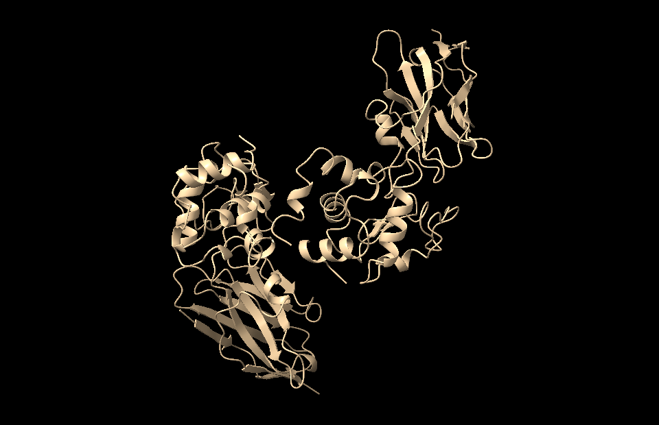 | 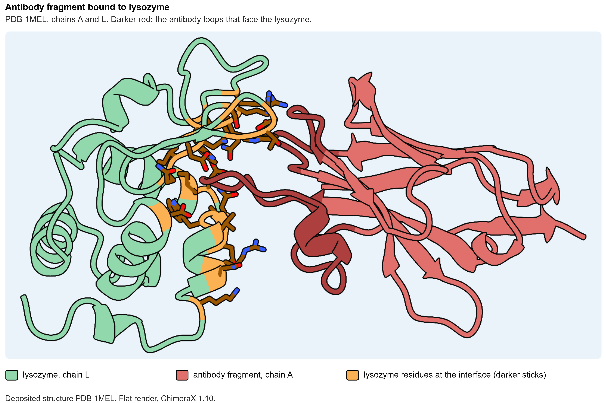 |
| 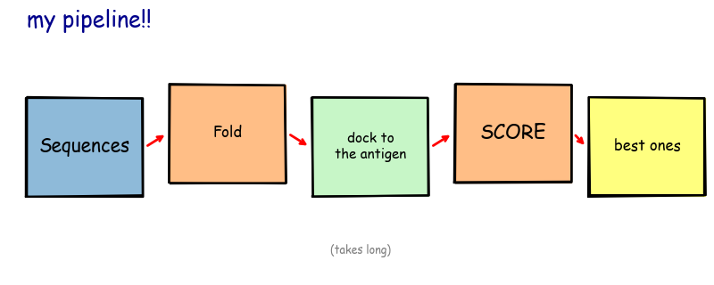 | 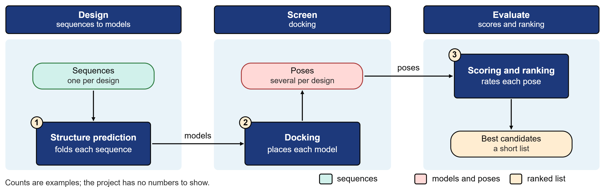 |

## Settings

Copy `molecullage.example.json` to `molecullage.json` in your figure project. The build, the QA script and the hooks use the nearest `molecullage.json` above the page.

| Setting | Where | What it does |
|---|---|---|
| `strictness` | `molecullage.json` | `normal`, `strict` or `loose`: the limits of the QA checks (see below). |
| `palette` | `molecullage.json` | The token file. Default `tokens/tokens.base.json`. |
| `typeLadder` | `molecullage.json` | Type sizes in pt: panel letter 9, title 7.5, label 7, smallest text 6.5, maths 8.4. |
| `words` | `molecullage.json` | Word limits: 130 in a schematic, 90 in a plate, 6 per box, 3 per arrow, 14 in the footnote. |
| `widthMm` | `molecullage.json` | Allowed figure widths in mm: 178 and 89. |
| `claimBoundary` | `molecullage.json` | The footnote that `f.boundary()` writes: what is real data and what is illustration. |
| `review` | `molecullage.json` | Which independent reads a figure needs: `none`, `blind` or `blind+overclaim`. |
| `art` | `molecullage.json` | The folder of cropped renders. |
| `structures` | `molecullage.json` | Default parameters for each render group, for example `complex`. |
| `ignore` | `molecullage.json` | Folder names the inventory skips, for example `["before", "after"]`. |
| `hook` | `molecullage.json` | `false` turns the QA hook off for this project. |
| `hookBlocks` | `molecullage.json` | `true` makes the QA hook exit with code 2 when the checks fail at `strict`, so Claude Code reports the failure to Claude as an error. |
| `autotrigger` | `molecullage.json` | `false` turns the prompt reminder off for this project. |
| `MOLECULLAGE_HOME` | environment | The clone folder. The MCP server and the hooks find it from their own location if it is not set. |
| `MOLECULLAGE_CHROME` | environment | The path of Chrome, Edge or Chromium. |
| `MOLECULLAGE_CHIMERAX` | environment | The path of the ChimeraX executable. |
| `MOLECULLAGE_PYTHON` | environment | The Python command, if `py -3` on Windows or `python3` elsewhere is not the one you want. |
| `MOLECULLAGE_TOKENS` | environment | A token file for the plot and render scripts, used in place of `palette`. |
| `MOLECULLAGE_ART` | environment | The folder the render scripts write to, used in place of `art`. |
| `MOLECULLAGE_CONFIG` | environment | The `molecullage.json` the render scripts read, if not the one in the current folder. |

At `normal`, a figure passes when ink is at least 9 %, empty cells at most 25 %, the longest empty band at most 4 % of the height, the largest blank rectangle at most 6 % of the area, the smallest text at least 6.5 pt and every picture at least 20 mm wide. `strict` raises the limits (ink 20 %, cells 20 %, band 2.5 %, blank 4 %), and too many words, a font other than Arial or a wrong width then fail too. `loose` uses the normal limits but reports failures as warnings and exits with code 0. The limits are close to values measured on a set of published antibody-design figures; treat them as a guide. `docs/glossary.md` explains each measurement.

## Drawing rules and palette

`docs/grammar.md` lists the 25 drawing rules, and each one says what goes wrong when you break it. `docs/palette.md` explains how the palette was sampled, how colours get their roles, and how to swap in your own.

## Licence

The code is under the MIT License (`LICENSE`). The documentation and the example figures are under Creative Commons Attribution 4.0 International, CC BY 4.0 (`LICENSE-docs`). The PDB files in `data/pdb/` are copies of public entries from the wwPDB, which releases them under CC0.

## Credits

- Palette: I sampled the colours from Fig. 8, and the plot colours from Figs 1, 4 and 7, of my paper NanoDeNovo (Kotelnikov, Tatarinova and Zhdanov, Int. J. Mol. Sci. 2025, 26, 9262, doi 10.3390/ijms26199262, open access). Only the hex values are in this repository.
- Structures: PDB entries 1MEL, 1VFB, 4KRL, 7Z0X and 1IGT from the RCSB Protein Data Bank. The files in `data/pdb/` come with the records they were checked against.
- Icons: Tabler Icons (MIT), installed by npm.
- Libraries: Playwright (Apache 2.0) drives the browser; the Model Context Protocol SDK (MIT) and zod (MIT) run the MCP server; NumPy, Pillow, SciPy, scikit-image and matplotlib do the measuring, sampling and plotting, and PyMuPDF (AGPL-3.0, installed with pip, not included here) reads PDFs.
- Colour-vision simulation: Machado, Oliveira and Fernandes (2009).
- Optional tools, not included: UCSF ChimeraX for renders, PDBe Arpeggio and Open Babel for typed contacts.

Formerly published as structfig and figpilot.
