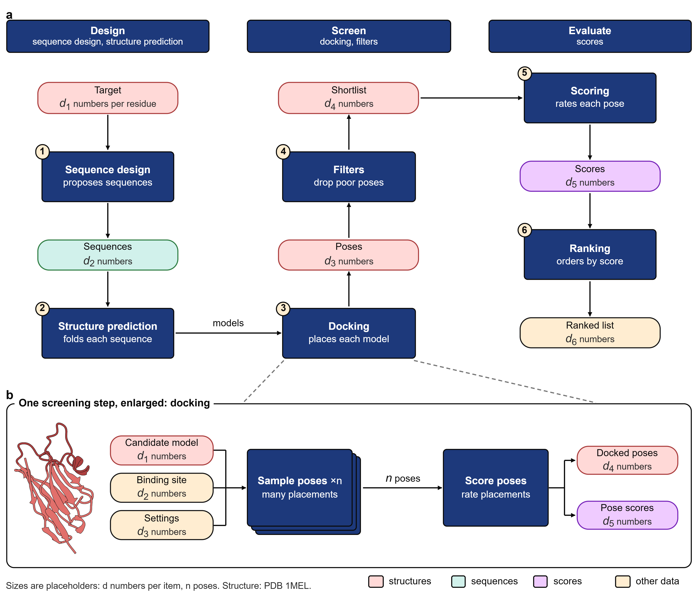

# structfig

structfig builds figures of protein structures, sequences, contacts and pipelines for papers. A figure is an HTML page in millimetres. The build prints it to a vector PDF with live Arial text and to a 600 dpi PNG. Structures come from ChimeraX in one flat style, plots from matplotlib, and every figure is measured against a short list of checkable rules.



The picture is `examples/pipeline`, built from `templates/pipeline.html`: a screening pipeline in three stages, with one step enlarged. Its sizes are placeholders; the structure is PDB 1MEL.

## Start

You need Node 20 or newer, Python 3.10 or newer, and Chrome, Edge or Chromium. ChimeraX 1.10 is needed only to make new renders.

```
git clone https://github.com/danilkotelnikov/structfig
cd structfig
npm ci
pip install -r requirements.txt
node scripts/build_examples.mjs sequence plots2     # two examples, into examples/<name>/
py -3 -I qa/qa_fig.py examples/sequence/sequence    # python3 on Linux and macOS
```

The QA line prints the marks and the reason for each one that fails. This one ends in ok. It adds a warning about words, because the letters of the sequence count as words. Set `STRUCTFIG_CHROME` if the build cannot find a browser.

All examples pass at normal strictness except `palette`, a reference sheet with wide margins. Its `notes.md` says why.

## What is in it

| Folder | What it holds |
|---|---|
| `kit/` | The page kit: cards, pills, stage strips, routes, labels, maths in Arial. `docs/kit.md` |
| `build/` | `build.mjs`: page to PDF and PNG, icons, plot layers, data files, palette remap |
| `templates/` | Eight pages to copy and edit |
| `examples/` | Each template built on public PDB entries, with a `notes.md` that records the data, the tool versions and the QA marks |
| `struct/` | ChimeraX renders (`render.py`), the lock wrapper, trimming with anchors, typed contacts |
| `plots/` | The matplotlib layer: millimetre canvas, palette from the token file, a contact tile map |
| `palette/` | Sampler, colour-vision check, token builder. `docs/palette.md` |
| `tokens/` | The shipped palette as a token file |
| `qa/` | `qa_fig.py` (the marks), the two reader briefs, the leak scan |
| `art/` | The trimmed renders that the examples use |
| `data/pdb/` | Public coordinate files and the RCSB records they were checked against |
| `docs/` | Grammar, lessons, ChimeraX, palette, kit, glossary |

## Templates and examples

| Template | Shows | Data |
|---|---|---|
| `pipeline` | a screening pipeline in three columns: stage strips, tool blocks, data pills, badges, an enlarged block | placeholders, 1MEL |
| `sequence` | letters per cell, tracks for loops and observed residues, three nested sets | 1MEL chain A |
| `contacts` | typed contact tiles, split tiles, a close-up with leaders | 1MEL, computed with PDBe Arpeggio 1.4.4 |
| `series` | noise to structure in five frames, t under each | 1MEL chain A |
| `dates` | entries by kind of date against a cut-off | 1VFB, 1MEL, 4KRL, 7Z0X |
| `plots2` | two matplotlib panels under kit labels at shared boxes | 1MEL, 4KRL |
| `structures` | separate panels for separate objects | 1MEL, 7Z0X, 1IGT |
| `palette` | every family, contrast, colour-vision distances | the token file |

## Settings

Copy `structfig.example.json` to `structfig.json` next to your pages. The build and the QA script read the nearest one above the page.

| Key | Meaning |
|---|---|
| `strictness` | `normal`, `strict` or `loose`; changes the QA limits (below) |
| `palette` | token file |
| `typeLadder` | letter 9, title 7.5, label 7, floor 6.5, math 8.4 (pt) |
| `words` | word budgets: schematic 130, plate 90, per box 6, per arrow 3, footnote 14 |
| `widthMm` | accepted figure widths, 178 and 89 |
| `claimBoundary` | the one-line footnote that `f.boundary()` writes |
| `review` | `none`, `blind` or `blind+overclaim`: which reads the project requires |
| `chimerax` | `auto` or a path |

Terms such as ink, band and blank rectangle are explained in `docs/glossary.md`. The limits are close to what we measured on a set of published antibody-design figures; use them as a guide.

Strictness changes the marks. `normal`: ink at least 9 %, empty cells at most 25 %, longest empty band at most 4 %, largest empty rectangle at most 6 %, type at least 6.5 pt, pictures at least 20 mm. `strict`: tighter limits (ink 20 %, cells 20 %, band 2.5 %, blank 4 %), and words, fonts and width fail too. `loose`: the normal limits, reported as warnings, exit code 0.

## Structures

```
py -3 -B struct/run_cx.py struct/render.py complex name=mel pdb=data/pdb/1MEL.pdb binder=A antigen=L drop=B,M cdr=1mel_vhh
py -3 -B struct/trim.py
```

A ChimeraX window opens for a few seconds. See `docs/chimerax.md`. `scripts/render_examples.py` makes every render of the examples. Set `STRUCTFIG_CHIMERAX` to the executable.

## Palette

The shipped palette was sampled from the flat fills of Fig. 8 of Int. J. Mol. Sci. 2025, 26, 9262 (doi 10.3390/ijms26199262, open access). Only hex values are here. The dark tones are derived, and the token file says which. Sample your own paper with `palette/sample_palette.py`. Details and the colour-vision numbers are in `docs/palette.md`.

## Tests

```
npm test                  # Node: kit maths, remap, config, a real build when a browser is present
py -3 -m pytest -q tests  # Python: sampler, palette, QA marks, contacts, data checks, leak scan
```

The ChimeraX test runs only when `STRUCTFIG_CHIMERAX` is set. No GPU is needed.
Before you publish a figure repository, run `py -3 -I qa/leak_scan.py`. It looks for personal paths and tone slips in the files a commit would hold. It also reads a deny list of your own, with the project names and private numbers you must not publish. Keep that list outside the repository (`~/.structfig/denylist.txt`, or the file named in `STRUCTFIG_DENYLIST`), so the list itself never gets published.

## Not covered

structfig does not draw 3D scenes outside ChimeraX, does not edit figures by hand, and does not make images with generative models. The kit has the blocks that the templates use; extra helpers belong in the page. Entries must be checked against the RCSB record by you: `scripts/fetch_pdb.py` fetches the file and the record, and `tests/test_data.py` compares dates and chains.

## Companion

[figpilot](https://github.com/danilkotelnikov/figpilot) wraps these tools as a Claude Code skill, an opt-in hook and an MCP server.

## Licence

Code: MIT (`LICENSE`). Documentation, examples and their data: CC BY 4.0 (`LICENSE-docs`). Coordinates under `data/pdb` come from the RCSB Protein Data Bank.
