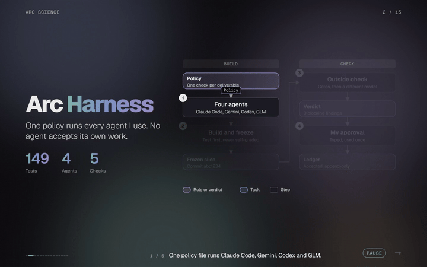
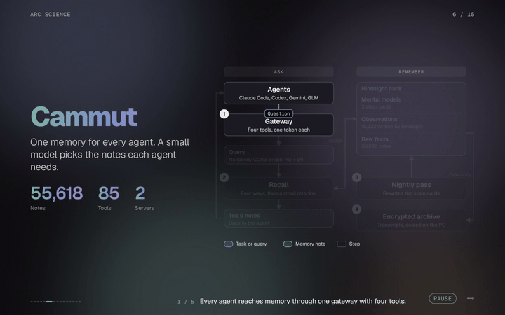
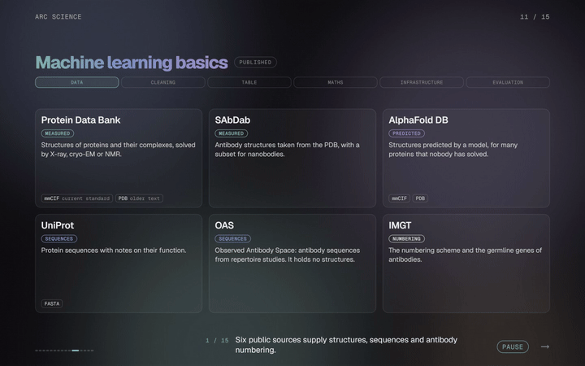

# Arc Science, under the hood

A deck about the tools behind Arc Science: the agent harness, the Cammut memory layer, the basics of machine learning, shape and charge in antibody binding, a small-molecule method and a roadmap. It shows a real molecule where a shape explains the idea.

The deck is one HTML file. Arrow keys, space or a swipe walk the steps of a slide. P plays and pauses.

## Slides in this folder

- Harness: `harness`, `harness2`, `m1`, `m2`.
- Memory: `cammut`, `cq` (type a question and follow it), `m3`, `m5`.
- Workbench: `arcsci`.
- Science: `ml` (machine learning basics), `o7` (shape and charge), `n3` (a small-molecule method).
- Roadmap: `rd`.

Slides about models and projects that are not published are not included. Neither are the notes of the builders, the baked 3D meshes and the fact sheets.

## Files

- `base-m.html`: the page, the keys and the autoplay.
- `<key>.html`: one slide each.
- `dg.html`, `mk.html`, `rt.html`, `x3.html`: the kits for diagrams, maths beats, route slides and 3D scenes.
- Tools: `assemble3.py`, `build_deck.py`, `steps.mjs`, `smoke.mjs`, `look.mjs`, `autoplay.mjs`, `chiptest.mjs`, `palcheck.py`, `record.mjs`, `bake.py`, `data3d.py`, `corpus_set.py`.

## Build

The checks need Python 3, Node 18 or newer and Google Chrome (they drive it with Playwright, from the repository root). On Linux or macOS write `python3` where this page says `py -3`.

Flat slides need nothing more:

```
NO3D=1 py -3 assemble3.py flat.html cq,m1,m2,m3,m5
```

The slides `o7` and `n3` are 3D and need meshes. The structure files are not stored here. `bake.py` names the public entries it reads. The two slides use 1MEL, 4KRL and 181L; the script also bakes a few more, so fetch every entry it names (1A34 also needs its assembly 1 file from files.rcsb.org) into `data/pdb/` with `scripts/fetch_pdb.py`, then run `py -3 bake.py` and `py -3 data3d.py`. They write `x3mesh.html` and `x3data.html`. After that the whole deck builds and is checked with one command:

```
py -3 build_deck.py --out deck.html
```

`corpus.json` holds the size of the memory bank that the memory slides show. `corpus_set.py` refreshes it.

## Checks

- `smoke.mjs` opens every slide, plays every step at high speed and reports page errors and parts of one slide that stay visible on another.
- `steps.mjs` walks every step of every slide on a desktop and a phone screen and reports overlap, long captions and forbidden words.
- `look.mjs` takes one frame at the true end of a beat.
- `palcheck.py` measures the colours of a frame against the palette.
- `autoplay.mjs` tests play, pause and manual steps. `chiptest.mjs` tests the clickable chips.
- `record.mjs` records a range of slides as an MP4.

## Evidence levels

A picture carries tags: Measured, Published structure, Computed, Concept values, Plan or Designed. A picture tagged Concept values never shows a measured number.

## Snippets






