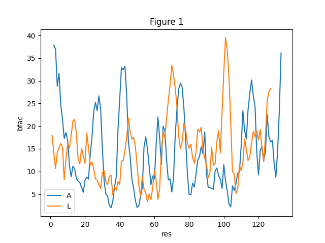

# Sample project with three poor figures

A small project for trying the Molecullage redesign of a whole project. It has three figures of the kind a first draft often contains. The data are public: PDB entry 1MEL (a camel single-domain antibody fragment bound to hen lysozyme), read from `data/pdb/1MEL.pdb` of the Molecullage folder.

Figure 1. B-factors of the C-alpha atoms of chain A (antibody fragment) and chain L (lysozyme) in PDB 1MEL.

Figure 2. Screening pipeline: sequences are folded, docked to the antigen and scored; the best ones are kept.

Figure 3. Structure of the antibody fragment bound to lysozyme, PDB 1MEL.

## Try it

Open Claude Code in this folder and say: "Redo all figures of this project."

Folders:

- `figures/` the three originals. Nothing in it is changed.
- `scripts/` how the three originals were made.
- `before/` and `after/` the originals and the redesigned figures, to compare by eye.
- `molecullage/` what the redesign wrote: `INVENTORY.md`, `AUDIT.md`, `PLAN.md`, `decisions.md`, a sheet that puts old and new side by side, and one folder per figure with its page, PDF, PNG and notes.

`how-made.md` lists the steps and the commands behind the files in `molecullage/`.
