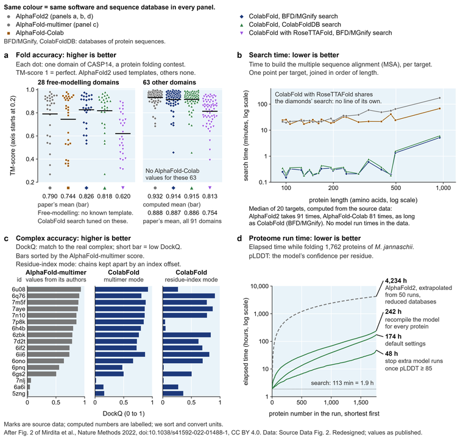
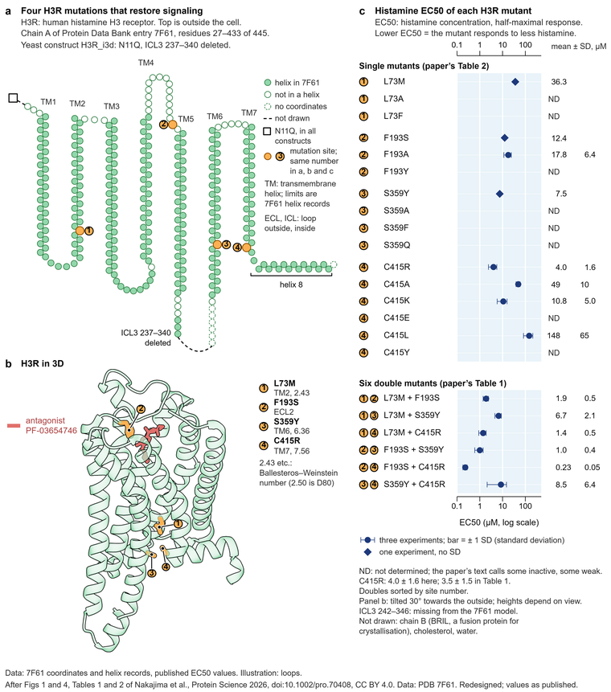
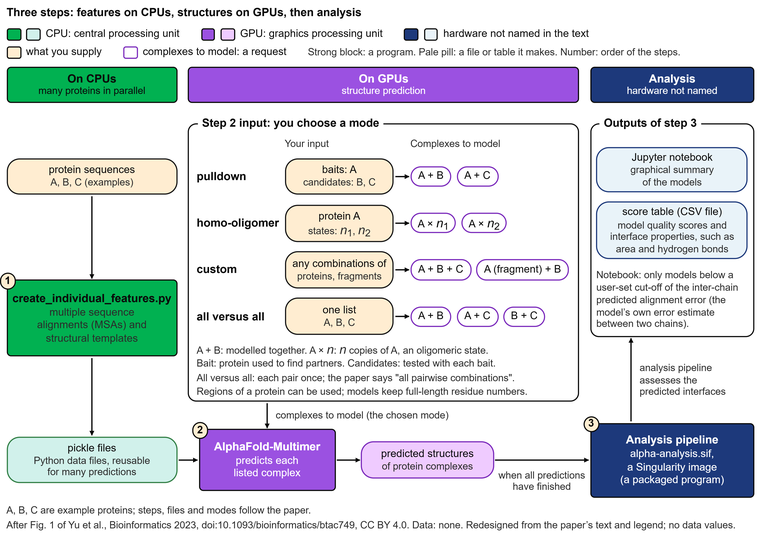
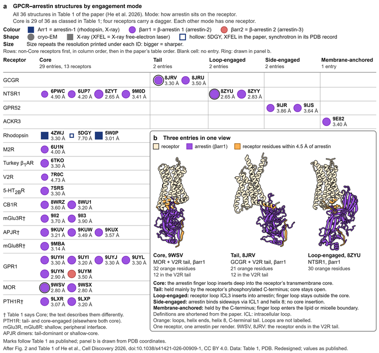
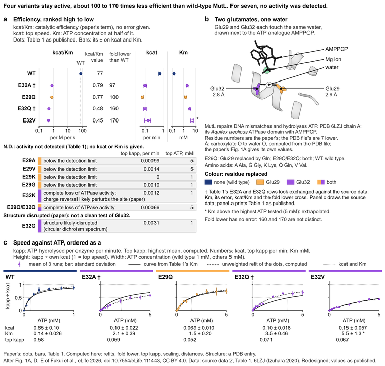

# Gallery

11 figures from open-access papers, redrawn with Molecullage. Each one keeps the data of the paper it comes from and says on the figure where the original is. The originals are not copied here: follow the DOI to see them. Every paper is published under CC BY 4.0, and each redesign carries a credit line for it.

How a piece got here: the original figure and its legend were read first, then the figure was rebuilt from the paper's data or from the PDB entry. After each build, one reader saw only the picture and said what they could not decode, and another reader checked every number, label and claim against the paper and the data file. The builder fixed what they found. Where a figure says "computed", the number comes from the data and not from the paper; where the paper and its own data disagree, the figure says so.

| Redesign | What it is and what changed |
|---|---|
|  | **Mechanism, six cryo-EM structures**  Redesign of Fig. 1A, 2A, 4A and 5A of Lee, Manon and Chen, Immunity 2025, 58(9):2166, [doi:10.1016/j.immuni.2025.08.003](https://doi.org/10.1016/j.immuni.2025.08.003).  One cycle of six states in a common orientation, with the measured gap between the nucleotide-binding domains, in place of four small schematics spread over four figures.  [PDF](01-tap-cycle/01-tap-cycle.pdf) · [how it was made](01-tap-cycle/how.md) · [page source](01-tap-cycle/page/01-tap-cycle.html) |
|  | **Ligand pocket, 3D and 2D**  Redesign of Fig. 5A and B of Bu et al., Nature Communications 2026, 17:10401, [doi:10.1038/s41467-026-77332-3](https://doi.org/10.1038/s41467-026-77332-3).  The same 20 contacts in a 3D view and in a flat drawing of the compound, every line typed (hydrogen bond, cation-pi, hydrophobic) and measured from the coordinates.  [PDF](02-ebola-pocket/02-ebola-pocket.pdf) · [how it was made](02-ebola-pocket/how.md) · [page source](02-ebola-pocket/page/02-ebola-pocket.html) |
|  | **Benchmark plots**  Redesign of Fig. 2 of Mirdita et al., Nature Methods 2022, 19:679, [doi:10.1038/s41592-022-01488-1](https://doi.org/10.1038/s41592-022-01488-1).  Four plots on one colour code, with the means, the caveats and the units printed next to the data.  [PDF](03-colabfold-benchmark/03-colabfold-benchmark.pdf) · [how it was made](03-colabfold-benchmark/how.md) · [page source](03-colabfold-benchmark/page/03-colabfold-benchmark.html) |
|  | **Graphical abstract as an infographic**  Redesign of Graphical abstract and Fig. 2A of Kalchschmidt et al., Cell Reports 2025, 44:116361, [doi:10.1016/j.celrep.2025.116361](https://doi.org/10.1016/j.celrep.2025.116361).  The 47 reporter genes in readable type, the screen counts as proportional bars and the drug effects as aligned bars with real values.  [PDF](04-bcell-pathway/04-bcell-pathway.pdf) · [how it was made](04-bcell-pathway/how.md) · [page source](04-bcell-pathway/page/04-bcell-pathway.html) |
|  | **Large complex, 34 chains**  Redesign of Fig. 1 of Fry et al., Cell 2026, 189:6307, [doi:10.1016/j.cell.2026.08.057](https://doi.org/10.1016/j.cell.2026.08.057).  All 34 chains as flat surfaces coloured by module, with a key that ties every subunit to its PDB chain ids.  [PDF](05-atp-synthase/05-atp-synthase.pdf) · [how it was made](05-atp-synthase/how.md) · [page source](05-atp-synthase/page/05-atp-synthase.html) |
|  | **Snake plot linked to a structure**  Redesign of Fig. 1 and 4, Tables 1 and 2 of Nakajima et al., Protein Science 2026, 35:e70408, [doi:10.1002/pro.70408](https://doi.org/10.1002/pro.70408).  Four mutation sites on the snake plot and on the crystal structure, with the EC50 of every mutant on one log axis.  [PDF](06-gpcr-snake-plot/06-gpcr-snake-plot.pdf) · [how it was made](06-gpcr-snake-plot/how.md) · [page source](06-gpcr-snake-plot/page/06-gpcr-snake-plot.html) |
|  | **Deep mutational scan heat map**  Redesign of Fig. 2A of Taylor and Starr, PLoS Pathogens 2026, 22:e1014074, [doi:10.1371/journal.ppat.1014074](https://doi.org/10.1371/journal.ppat.1014074).  Both backgrounds on shared columns, the ACE2-contact sites first, and the structure coloured with the same scores.  [PDF](07-rbd-mutational-scan/07-rbd-mutational-scan.pdf) · [how it was made](07-rbd-mutational-scan/how.md) · [page source](07-rbd-mutational-scan/page/07-rbd-mutational-scan.html) |
|  | **Annotated evolutionary tree**  Redesign of Fig. 3A and 4A, B of Cuevas Zuviria et al., eLife 2025, 14:RP105613, [doi:10.7554/elife.105613](https://doi.org/10.7554/elife.105613).  A tree that can be read: clades as bands, insertion events marked, structural attributes in a side matrix and structure insets tied to their clades.  [PDF](08-nitrogenase-tree/08-nitrogenase-tree.pdf) · [how it was made](08-nitrogenase-tree/how.md) · [page source](08-nitrogenase-tree/page/08-nitrogenase-tree.html) |
|  | **Software workflow**  Redesign of Fig. 1 of Yu et al., Bioinformatics 2023, 39:btac749, [doi:10.1093/bioinformatics/btac749](https://doi.org/10.1093/bioinformatics/btac749).  CPU and GPU steps colour-coded and named, the four modes drawn as what they pair, file names on the files.  [PDF](09-alphapulldown-workflow/09-alphapulldown-workflow.pdf) · [how it was made](09-alphapulldown-workflow/how.md) · [page source](09-alphapulldown-workflow/page/09-alphapulldown-workflow.html) |
|  | **Landscape of structures**  Redesign of Fig. 2 and Table 1 of He, Zhao and Xu, Cell Discovery 2026, 12:61, [doi:10.1038/s41421-026-00909-1](https://doi.org/10.1038/s41421-026-00909-1).  All 36 structures of a table on one grid by receptor and engagement mode, with resolution, technique and arrestin type, and three renders.  [PDF](10-arrestin-landscape/10-arrestin-landscape.pdf) · [how it was made](10-arrestin-landscape/how.md) · [page source](10-arrestin-landscape/page/10-arrestin-landscape.html) |
|  | **Enzyme kinetics, small multiples**  Redesign of Fig. 1A, D, E and Table 1 of Fukui et al., eLife 2026, 15:RP111443, [doi:10.7554/elife.111443](https://doi.org/10.7554/elife.111443).  Efficiency ranked in one panel, each variant's curve and fit in its own tile, and the two Table 1 rows that look exchanged marked.  [PDF](12-mutl-kinetics/12-mutl-kinetics.pdf) · [how it was made](12-mutl-kinetics/how.md) · [page source](12-mutl-kinetics/page/12-mutl-kinetics.html) |

## Rebuild a piece

Each folder has a `fetch_data.py` that downloads the inputs (PDB files and the paper's source-data file) into `data/`, prints their size and SHA-256 and stops if a file has changed. No third-party data file is stored in the repository. Then follow the commands in the folder's `how.md`. ChimeraX is needed only to redo the structure renders; the renders are included.

## Credit and licence

The papers are under CC BY 4.0 (read from the Europe PMC record and from the article itself). The redesigned figures are under CC BY 4.0 as well, with the credit line printed on each. The code in the folders is under the MIT licence. The word counts that the QA script flags as warnings come from gene names, residue labels and numbers, which a figure of this kind has to print.
